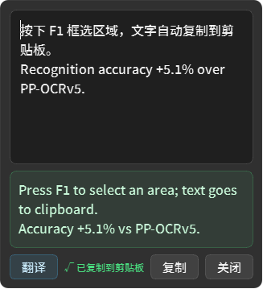
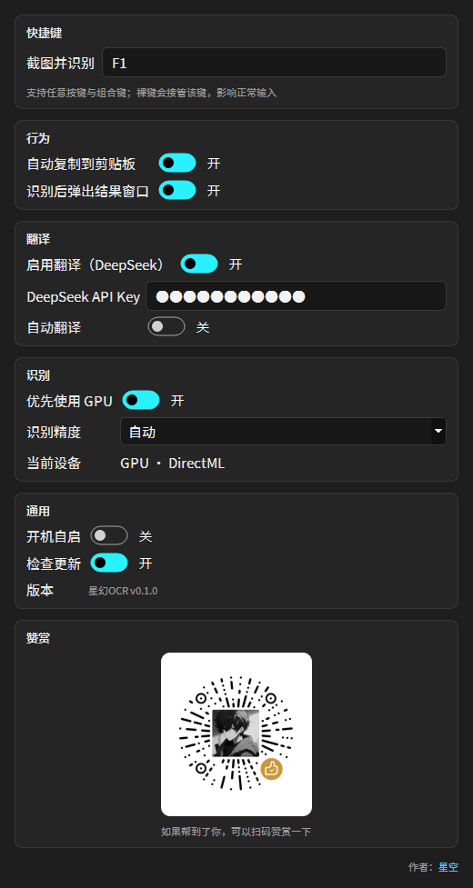

<div align="center">


# 星幻OCR

**按一下 F1，框选屏幕，文字立刻进剪贴板。**

Windows 截图 OCR 工具 · 中文离线识别 · 免费开源

[](LICENSE)
[](#系统要求)
[](#从源码运行)
[](https://github.com/PaddlePaddle/PaddleOCR)
[](https://onnxruntime.ai/)

截图取字 · 屏幕文字识别 · 图片转文字 · 离线 OCR · 中文 OCR 工具

</div>

---

## 它是什么

星幻OCR 是一个常驻托盘的**截图取字工具**。在任何程序里按 `F1`，屏幕变暗，拖框选中一块区域，松手——文字已经进了剪贴板，同时弹出一个小窗口可以顺手改一下。

识别全部在**本机离线**完成：内置 PaddleOCR 的 PP-OCRv6 模型，用 ONNX Runtime 推理，不传图、不联网、不排队。

<div align="center">
  
</div>

## 特性

| | |
|---|---|
| ⚡ **按完就出** | 蒙层约 120 ms 出现；框选松手到文字出现，GPU 上约 0.1 秒，CPU 上约 0.2–1.5 秒 |
| 🎯 **PP-OCRv6 精度** | 屏幕文字识别准确率 79.7%（small）/ 82.5%（medium），比上一代 PP-OCRv5 高 11–22 个百分点 |
| 🖥️ **GPU 优先** | 自动探测 CUDA / DirectML / CPU，笔记本核显和 N 卡都能加速，无需安装 CUDA |
| 🔒 **离线私有** | 模型随安装包（163 MB），识别过程零联网，图片和文字都不出本机 |
| 🌍 **50 种语言** | 中、英、日 + 46 种拉丁语系，一个模型搞定，不用切语言 |
| 🌐 **可选翻译** | 填上自己的 DeepSeek API Key，结果窗多一个「翻译」按钮，还能自动翻译 |
| ⌨️ **任意快捷键** | F1–F24、PrintScreen、方向键、小键盘、标点，任意组合键都能设 |
| 🎨 **深色亚克力** | 思源黑体 + 深色圆角窗口，不抢焦点、点窗外自动收起 |

## 下载安装

到 [Releases](../../releases) 下载 `星幻OCR_Setup_v*.exe`，双击安装，**无需管理员权限**，默认装到 `%LOCALAPPDATA%\Programs\星幻OCR`，带桌面快捷方式与卸载项。

也可以直接用绿色版：解压后双击 `StarHuanOCR.exe`。

### 系统要求

- Windows 10 1903+ 或 Windows 11（x64）
- 约 600 MB 磁盘空间（含两档模型）
- 有 NVIDIA / AMD / Intel 显卡时自动启用 GPU 加速，没有也能跑

## 使用

```
F1  →  屏幕变暗  →  拖拽框选  →  松手  →  文字已在剪贴板，结果窗浮现
```

| 操作 | 说明 |
|---|---|
| `F1` | 截图并识别（可在设置里改成任意按键） |
| 左键点托盘图标 | 同样直接截图 |
| 右键点托盘图标 | 截屏 / 设置 / 检查更新 / 退出 |
| `Esc`、右键、双击 | 取消框选 |
| `Ctrl+Enter` | 复制结果 |
| 拖动窗口留白边 | 移动结果窗口 |
| 点结果窗外面 | 自动关闭 |

## 设置

设置页一页到底，改完**即时生效并自动保存**，不需要「确定」按钮。

| 分组 | 项 | 默认 |
|---|---|---|
| 快捷键 | 截图并识别 | `F1` |
| 行为 | 自动复制到剪贴板 / 识别后弹出结果窗口 | 开 / 开 |
| 翻译 | 启用翻译（DeepSeek）/ API Key / 自动翻译 | 关 / 空 / 关 |
| 识别 | 优先使用 GPU / 识别精度 | 开 / 自动 |
| 通用 | 开机自启 / 检查更新 | 关 / 开 |

<div align="center">
  
</div>

**识别精度**：`自动` 会在 GPU 上选 medium（更准）、CPU 上选 small（更快）；也可以手动锁定。两档模型都在安装包里，切换不需要下载。

**翻译**：开启后，结果窗口会多一个「翻译」按钮。接口用的是 DeepSeek 官方 `https://api.deepseek.com/chat/completions`，Key 只存在本机 `%APPDATA%\StarHuanOCR\config.json`。

## 与其它截图 OCR 的差别

| | 星幻OCR | 典型截图 OCR |
|---|---|---|
| 识别模型 | PP-OCRv6（2026） | PP-OCRv3/v4 一代 |
| 推理引擎 | ONNX Runtime，CPU/GPU 可切 | 多为纯 CPU 或绑定 CUDA |
| 安装包 | 绿色安装，无需管理员 | 常需装运行库或 CUDA |
| 联网 | 识别零联网 | 部分工具会联网 |
| 开源 | GPL-3.0，代码全给 | 多数闭源 |

## 技术栈

```
PySide6 + PySide6-Fluent-Widgets   界面（深色 + DWM 亚克力）
RapidOCR 3.10 + ONNX Runtime      推理（PP-OCRv6 det + rec）
PaddleOCR PP-OCRv6                模型来源
PyInstaller                       onedir 打包
Inno Setup                        安装包
```

**架构**

```
main.py                 入口：单实例 → 主题/字体 → 托盘 + 热键 + 引擎预热
app/capture.py          虚拟桌面截屏（多屏 / DPI 感知）
app/overlay.py          全屏蒙层与框选
app/ocr/engine.py       PP-OCRv6 引擎，设备自动选择，单工作线程
app/ocr/layout.py       检测框 → 按行排版
app/pipeline.py         热键 → 框选 → 识别 → 复制 / 弹窗
app/ui/*                结果窗、设置窗、托盘、图标、字体
app/translate.py        DeepSeek 翻译
app/updater.py          GitHub Release 版本检查
```

## 从源码运行

```bash
git clone https://github.com/Ker0el/StarHuanOCR.git
cd StarHuanOCR
python -m venv .venv
.venv\Scripts\python -m pip install -r requirements.txt
.venv\Scripts\python main.py
```

**模型**：仓库不包含 163 MB 的 ONNX 模型，放到 `models\` 即可（文件名固定）：

```
models\PP-OCRv6_det_small.onnx
models\PP-OCRv6_rec_small.onnx
models\PP-OCRv6_det_medium.onnx
models\PP-OCRv6_rec_medium.onnx
```

模型可从 [RapidOCR 模型库](https://www.modelscope.cn/models/RapidAI/RapidOCR) 获取（PP-OCRv6 small / medium 的检测与识别模型）。

**GPU 加速**：把 `onnxruntime` 换成 `onnxruntime-directml`（任何 DX12 显卡，免装 CUDA）或 `onnxruntime-gpu`（需 CUDA），代码无需改动。

## 打包

```powershell
powershell -ExecutionPolicy Bypass -File build\build.ps1        # CPU 版
powershell -ExecutionPolicy Bypass -File build\build.ps1 -Gpu   # GPU 版（DirectML）
ISCC.exe build\StarHuanOCR.iss                                  # 生成安装包
```

产物在 `dist\StarHuanOCR\` 与 `dist\installer\`。

## 常见问题

**F1 按了没反应？**
F1 可能被别的软件占用了。程序启动时会提示，右键托盘 → 设置里换一个组合键即可。裸键（比如单独一个 `Q`）会全局接管该键，影响正常打字，慎用。

**识别出来是空的 / 乱码？**
确认框选区域里有文字、且不太小（宽高至少 5 px）。手写体、艺术字、竖排文字识别率很低。

**全屏游戏 / 受保护视频截出来是黑的？**
D3D 独占全屏和 DRM 内容无法被普通方式截取，这是系统限制，不做绕过。

**「高精度」要下载模型吗？**
不用，两档模型都随安装包。

**杀毒软件报警？**
没有代码签名，SmartScreen 首次运行可能提示「未知发布者」。

## 隐私

- 识别全程在本机完成，**不上传图片**
- 联网行为只有两项，都可以关闭：
  1. **检查更新**：只请求 GitHub Releases 的版本号
  2. **翻译**（默认关闭）：开启后才把识别文字发到你自己的 DeepSeek 接口
- 所有配置都在 `%APPDATA%\StarHuanOCR\config.json`

## 致谢

- [PaddleOCR](https://github.com/PaddlePaddle/PaddleOCR) — PP-OCRv6 模型
- [RapidOCR](https://github.com/RapidAI/RapidOCR) — ONNX 推理封装
- [ONNX Runtime](https://onnxruntime.ai/) — 推理引擎
- [PySide6-Fluent-Widgets](https://github.com/zhiyiYo/PyQt-Fluent-Widgets) — 界面组件
- 思源黑体（Noto Sans SC）— SIL OFL 1.1

## 赞赏

如果这个小工具帮到了你，可以扫码请我喝杯水 ☕

<div align="center">
  
</div>

## 作者

**星空** · B 站主页：<https://space.bilibili.com/177308205>

## English

**StarHuanOCR** is a lightweight screenshot OCR tool for Windows. Press `F1`, drag a region, and the recognized text is copied to your clipboard instantly with an editable popup.

- Powered by PaddleOCR **PP-OCRv6** via ONNX Runtime — fully offline, no uploads
- GPU acceleration (CUDA / DirectML) with automatic CPU fallback
- 50 languages in one model, optional DeepSeek translation
- Dark acrylic UI, custom hotkey, autostart, single instance
- GPL-3.0, built with PySide6

*Keywords: screenshot OCR, screen text recognition, image to text, offline OCR, Chinese OCR, Windows OCR, PP-OCRv6, ONNX Runtime.*

## 许可

[GPL-3.0](LICENSE)
